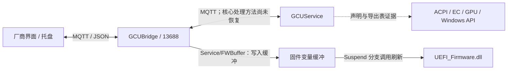

# MQTT 通信与已知消息

本文件前文保留第一轮静态证据。随后已实际连接本机并补齐查询与传感器读取证据，当前运行时范围见文末及 [MVP 审计](mvp-audit.md)。

## 结构

核心服务订阅和逐主题路由仍需恢复。图中的硬件连接不能视为本机所有功能都已完成调用链验证。

## 传输与会话

| 项目 | 静态证据 |
| --- | --- |
| 默认端口 | GCUBridge 的 `MQTT_SERVER/MQTTServer.cs`：`13688` |
| 原托盘连接目标 | `localhost:13688` |
| TLS | 托盘构造客户端时传入 `false`，原托盘路径未启用 TLS |
| 认证 | 客户端 ID、用户名、密码三者关联；本机分支与非本机分支不同 |
| 本机客户端族 | `BridgeType=0` 时 UWPClient；另有 MyKeyboard / MyTray / PluginClient 等族 |
| 账号槽位 | ClientManager 对相关族生成索引 0–19；原托盘固定使用 UWPClient 的索引 10 |
| 原托盘连接参数 | `Connect(clientId, username, password, false, (ushort)1)`；协议版本没有在已读调用处显式设置，暂不写死版本 |
| 原托盘订阅 QoS | 0 |
| 原托盘命令发布 | JSON 序列化，ASCII 编码，QoS 2，默认 retain=false |
| 原托盘消息读取 | UTF-8 解码再解析 JSON |
| 桥接主动发布 | JSON，retain=true，QoS 由调用者传入 |
| 桥接服务选项 | PersistentSessions，连接 backlog=100，每客户端待发消息上限=5 |

认证构造规则已在本地桥接和托盘反编译代码中找到，不把凭据复制进协议目录。后续连接器需要检查客户端 ID 占用，避免复用原托盘索引；本轮没有连接或探测任何账号槽位。非本机认证还有独立的 AES 解码分支，当前不实现远程控制。

JSON 的大小写、字符串数字和 retain 行为应按具体路径处理。ASCII 发布的事实只覆盖原托盘这条实现，不能推断全部前端都使用 ASCII。没有恢复业务 ACK、request ID 或统一错误响应，MQTT 的发布确认不能替代硬件成功反馈。

## 原托盘的订阅主题

来自 `Tray/UWP_Refactor.DataService/MQTTDatsService.cs::InitlizeTopics`：

- `Fan/Status`
- `Languages/Info`
- `Tray/Status`
- `Customize/SupportInfo`
- `Languages/Control`
- `KeyboardManager/EnableStatus`

这六个主题是托盘实际订阅代码的证据，其他主题常量仅证明代码中存在名称。`Languages/Control`、`KeyboardManager/EnableStatus` 在原托盘中还能触发界面或进程行为，不应把订阅所有主题的完整原客户端当作无副作用观察器。

## 已确认发送格式的六条命令

发送端证据来自 `Tray/SystrayComponent/SystrayApplicationContext.cs`，精确文件和行号记录于 [commands.json](../protocol/commands.json)。所有条目 `enabled=false`，目录没有网络发送功能。

| 主题 | JSON | 证据及当前限制 |
| --- | --- | --- |
| Customize/SupportControl | `{"Action":"GETSUPPORT"}` | 连接成功后由原托盘发送；查询意图已知，核心处理方法未恢复 |
| Fan/Control | `{"Action":"GETSTATUS"}` | 连接成功后由原托盘发送；查询意图已知，无副作用尚未验证 |
| Fan/Control | `{"Action":"OPERATING_GAMING_MODE"}` | 原托盘游戏模式操作发送；实际联动与回读未验证 |
| Fan/Control | `{"Action":"OPERATING_OFFICE_MODE"}` | 原托盘办公模式操作发送；实际联动与回读未验证 |
| Fan/Control | `{"Action":"OPERATING_TURBO_MODE"}` | 原托盘狂暴模式操作发送；支持条件与实际联动未验证 |
| Fan/Control | `{"Action":"OPERATING_CUSTOM_MODE"}` | 原托盘自定义模式操作发送；配置依赖与实际联动未验证 |

**查询与修改共用 Fan/Control。** 需要按 topic + Action + 字段校验区分能力，而不是按主题后缀分类。此处的查询意图来自发送方用途，不是服务端只读证明。

## 已有消费端模型

原托盘用 `MyRamFan1p5` 反序列化 `Fan/Status`。提取的 60 个字段见 [fan-status-fields.json](../protocol/fan-status-fields.json)。主要包括：

- 运行模式与档位：`OperatingMode`、`GamingProfileIndex`、`OfficeProfileIndex`、`TurboProfileIndex`。
- 风扇：`FanBoostEnable`、`FAN_FanSwitchSpeed`、`FAN_SafetyProtect` 等。
- CPU：`CPU_PL1/PL2/PL4` 及对应 Maximum、电压和 TccOffset 等。
- GPU：核心 / 显存偏移、目标温度、TGP、DynamicBoost 和 WhisperMode 等。

许多字段在原模型中是 `string`，即使名字表示数值。单位、取值域、特殊值和本机实际返回类型都未验证；部分字段是 bool。消费端模型不证明所有机型都返回这些字段。

`Tray/Status` 的消费代码另读取 `IsAC`、`OperatingMode` 和可选的 `FanBoostEnable`，并随供电状态调整菜单。能力消费端读取 `TurboModeSupport`。这些代码说明实现需要关注供电和能力条件，不证明服务端已经强制保护所有条件。

状态路径可能含 retained 数据。未确认服务端每种状态是否带时间戳、序列号、在线状态或轮次标识，后续实现必须把“收到过旧状态”和“当前状态”分开，不能将其作为立即写回依据。

## 桥接服务中的写路径

来自 `GCUBridge/MQTT_SERVER/MQTTServer.cs::MqttServer_ApplicationMessageReceived`：

| 匹配条件 | 观察到的操作 |
| --- | --- |
| ClientId 包含 UWPClient 且主题包含 Service/SetPassword | 读取 `username/password`，更新远程认证变量并写 service.ini |
| ClientId 包含 UWPClient 且主题包含 Service/SetExitCommand | 触发 ClientMessage 回调；本版本 TimerService 中对应方法体为空，不据此宣称可结束进程 |
| 主题包含 Service/FWBuffer | 按 `mode` 为 Byte / UInt16 / UInt32 读取 `name/data`，写固件变量缓冲 |

这里使用 `Contains`，并非严格的主题相等匹配。目录只记录发现，不生成可发送的固件写请求。`Service/FWBuffer` 的分支没有相同的 ClientId 包含检查，但完整权限、网络可达性和运行效果没有进一步验证。

固件缓冲通过 `NvramVariable.SetFwVarsBuf` 保存；`TimerService.OnPowerEvent(Suspend)` 调用 `UpdateBufToFwVars`，后续进入 `SetFwVars` / `UEFI_Firmware.dll::WriteUefi`。这是存在延迟写入路径的静态证据，实际固件写入未测试。

因此“发送后立刻没变化”不能证明请求没有副作用。固件、服务设置、退出、EC 通用控制等不进入初期连接器的可发送集合。

## 其他主题

[declared-topics.json](../protocol/declared-topics.json) 保存托盘的 42 个主题常量及来源行号。显示 `Display/Control`、风扇 `Fan/Table` 等额外名称还见于前端原生字符串候选，但未恢复对应消息构造；不能拼接猜测 `Action` 或参数。

下一轮优先补齐状态观察所需的连接与订阅行为、真实响应字段和新鲜度，再分别恢复控制命令，不对未知主题做主动枚举或试发。

## 后续实际验证与 MVP

2026-10-18 实测 MQTT 3.1.1、PluginClient_19、clean session、七个状态订阅及三种固定请求。GETSUPPORT、GETSTATUS 的实际响应已验证；另从原厂系统监控页捕获 `System/Control` 的 `{"Action":"System_ON"}`，关闭原厂前端后独立请求，仍收到 CPU/GPU、风扇、电池状态。

运行时白名单定义于 `src/OpenRevo.Core/MqttProtocol.cs`，仅 Capabilities、FanStatus、EnableTelemetry 三种枚举请求。静态 `commands.json` 仍是原六条发送端证据目录，其 enabled=false 表示该目录本身不执行命令；不能用它代替当前客户端的运行时契约。

System_ON 启用共享采样计时器；原厂导航也会发送 System_OFF。MVP 不发送 OFF，以免停止其他客户端的监控。监控推送不会保证每个主题持续更新；应用不把保活成功视作传感器数据更新。

具体消息数量、真实字段类型、查询时间和原始文件 SHA256 见 [live-evidence.json](../protocol/live-evidence.json)，硬件写入仍未实现或验收。
